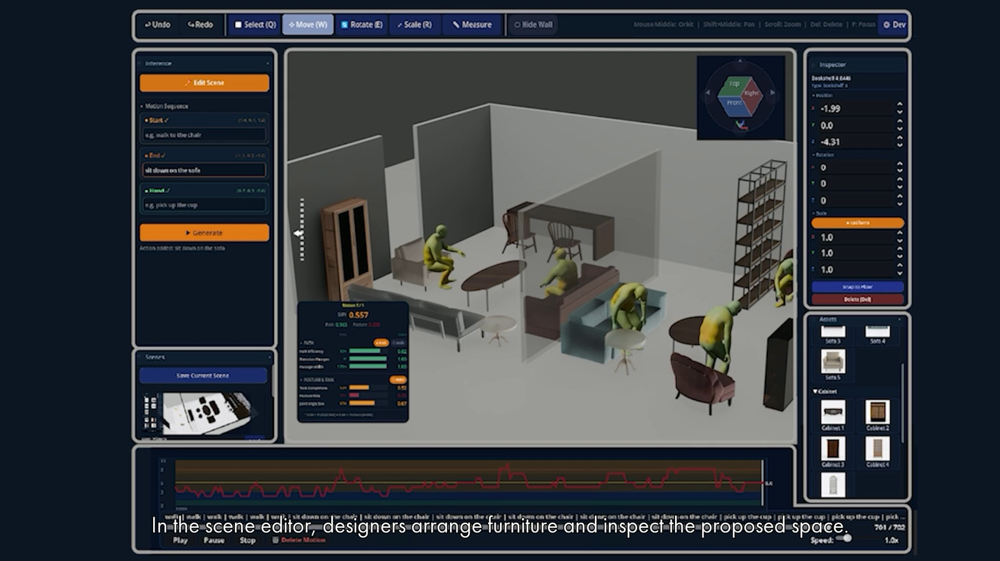

# OPM supplementary video

**[Download the supplementary video (MP4)](https://github.com/SeminJin/OPM/raw/refs/heads/main/Supplementary_Video.mp4)**

Click the thumbnail or the link above to download the video.

This repository provides the demonstration video accompanying **Supporting Indoor Layout Design through Synthesized Human Motion and Posture Feedback**.

Occupant Posture and Motion (OPM) supports indoor layout design through generated human motion and posture feedback. The video presents the system workflow, including task-based layout assessment, motion inspection, and reassessment after furniture edits.
